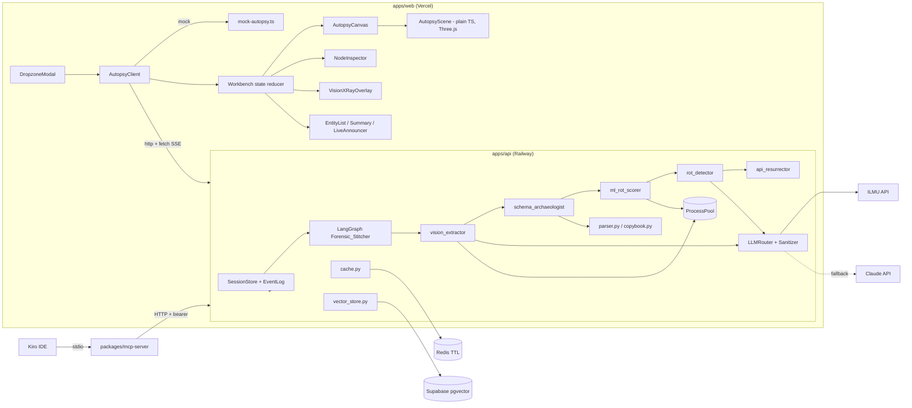
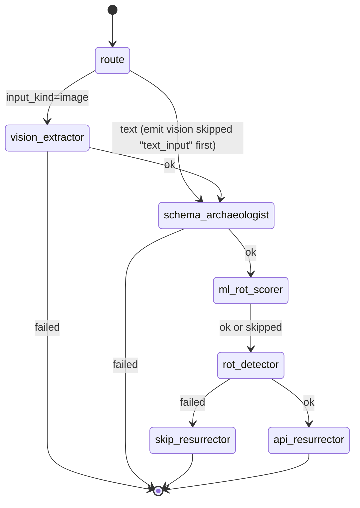
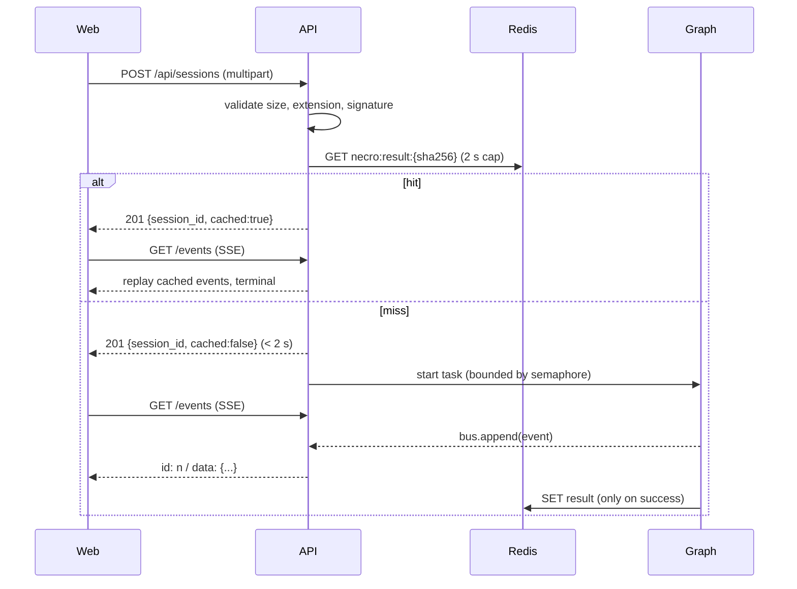

# Design Document

## Overview

NecroLegacy is a greenfield monorepo (the repository currently holds only `.gitignore`, `LICENSE` and `.kiro/`). It takes a legacy text dump, a COBOL copybook, or a scanned/photographed table, runs a five-node LangGraph pipeline, and presents the result in a Three.js "Autopsy Table", a Vision X-Ray image overlay, and a Kiro MCP server.

The five nodes run in a fixed order: `vision_extractor` (images only), `schema_archaeologist`, `ml_rot_scorer`, `rot_detector`, `api_resurrector`. Anything that can be computed deterministically is computed without an LLM: parsing, type inference, key inference, the six rule-based rot checks, IsolationForest scoring, PCA coordinates and code generation. LLMs are used only for (a) the vision-LLM table extraction fallback, (b) explaining the top ML outliers and referential breaks, and (c) a "silent corruption" sweep. Every LLM call goes through one router (ILMU first, Claude on failure within 3 seconds) and one sanitizer.

Delivery order is fixed by Requirement 19.8: **Phase 1** web app on typed mock data (including Vision X-Ray and spatial points), **Phase 2** FastAPI service with SSE, cache and vector search, **Phase 3** MCP server. To make Phase 2 a drop-in replacement, the web app talks to an `AutopsyClient` interface with two implementations (mock and HTTP) that emit the identical `SessionEvent` stream.

### Technology stack (locked on approval)

| Area | Choice |
|---|---|
| Monorepo | pnpm workspaces (`apps/web`, `packages/mcp-server`); Python project in `apps/api` with `pyproject.toml` + pinned `requirements.txt` |
| Web | Next.js 15 App Router, React 19 function components, TypeScript `strict`, Tailwind, shadcn/ui (Radix), Framer Motion, Three.js, Vitest + Testing Library + fast-check, Playwright + `@axe-core/playwright` |
| API | Python 3.12, FastAPI, Pydantic v2 + pydantic-settings, LangGraph `StateGraph`, httpx (LLM calls), `redis.asyncio`, `psycopg[binary,pool]` 3 + `pgvector`, `fastembed` (ONNX embeddings), `opencv-python-headless`, `numpy`, `scikit-learn`, PaddleOCR (CPU) + Tesseract, Jinja2 (codegen), pytest, pytest-asyncio, Hypothesis, respx, fakeredis |
| MCP | TypeScript on Node 20, `@modelcontextprotocol/sdk` (stdio transport), `ajv` for input validation, Vitest + fast-check |
| Infra | Vercel (web), Railway (api, root `Dockerfile`), Supabase Postgres + pgvector, Redis (Railway plugin), GitHub Actions |

Decisions that were open and are now closed:

- **Embeddings**: `fastembed` with `BAAI/bge-small-en-v1.5` (384 dims, ONNX, no PyTorch, consistent with 4.20/6.19). Rejected: ILMU/Claude embedding endpoints (not known to exist, adds a vendor dependency to search) and `sentence-transformers` (pulls PyTorch). The model weights are downloaded at image build time so cold starts need no network.
- **Vector search**: exact cosine scan filtered by a btree index on `session_key`, no ANN index. 50,000 vectors of 384 floats is a few tens of milliseconds, and an HNSW index would post-filter by session and return too few rows.
- **Session state**: in-process `SessionStore` (single Railway replica, documented). Redis stores only the completed-session event log used for caching. Rejected: Redis-backed live sessions (adds a second failure mode to every event, and 15.6 requires the pipeline to work with Redis down).
- **SSE client**: a `fetch` + `ReadableStream` parser, not `EventSource`, because 10.7 requires exactly 5 attempts with 1→16 s backoff and `EventSource` controls its own retry policy.
- **Blocking work isolation**: OpenCV/OCR and scikit-learn run in a `ProcessPoolExecutor` so the 45 s / 30 s timeouts can actually kill the work. Threads cannot be cancelled.
- **Polling for MCP**: the MCP server polls `GET /api/sessions/{id}` rather than consuming SSE. It is simpler, and each poll is bounded by the 30 s request timeout of 16.8.

### Assumptions

1. ILMU exposes an OpenAI-compatible `POST {ILMU_BASE_URL}/chat/completions` with JSON output and `image_url` data-URI inputs. This is unconfirmed; the adapter is isolated in `core/llm.py` so only one class changes if wrong.
2. Claude is called through the Anthropic Messages HTTP API with `ANTHROPIC_MODEL` (default `claude-sonnet-4-5`).
3. Presets are authored as multi-record-type files (a 2-character record-type prefix) so that multiple entities and cross-entity foreign keys exist. They are produced by `scripts/generate_presets.py` with a fixed seed and are fully synthetic.
4. Row numbers are 1-based positions in the parsed record list, with the header row counted as row 1 when present (for images, the grid row). Header rows are never entity data rows, so they never appear in anomalies.
5. Browser calls are protected by CORS plus unguessable UUIDv4 session IDs. Only the MCP server sends the optional bearer token (`API_TOKEN`). CORS is not authentication; this is accepted for a hackathon-scale tool and noted in Security.

### Requirement conflicts and how this design resolves them

| Conflict | Resolution |
|---|---|
| 3.1 allows `.cpy` up to 10 MB; 1.5/1.11 cap text uploads at 5 MB | The 5 MB upload limit applies at the API boundary. The parser has no lower internal cap and is tested to 10 MB. |
| 17.9 says any component fails to start on a missing credential; 8.5 says the router reports a configuration error and skips the provider; 7.9 defines "no provider" as a supported mode | Missing `ILMU_API_KEY` or `ANTHROPIC_API_KEY` disables that provider with a logged configuration error naming the variable (8.5 is the specific rule). `WEB_ORIGIN`, `REDIS_URL` and `SUPABASE_DB_URL` are start-fatal. |
| 17.9 vs 16.11 for the MCP server | The MCP server starts (Kiro must list its tools), logs the missing variable name to stderr, and returns the 16.11 error on every tool call. |
| 15.1 caches any successful session, but an indexing failure (14.2) leaves a session non-searchable for the TTL | Followed as written. A session whose indexing failed is still cached. Recorded as a known limitation; re-upload after TTL re-indexes. |
| 14.8 "requesting session" vs cache hits creating new session IDs | `Session.index_key` is the ID of the session that originally indexed the content. A cache hit reuses that key. Different content never shares a key. |

---

## Architecture



### Pipeline graph



### Request lifecycle



### Cross-cutting rules

- **One writer for events.** Only `EventLog.append` assigns IDs, under an `asyncio.Lock`. All nodes emit through a `NodeRunner` wrapper (`agents/graph.py`) that sends `started`, `completed`, `failed` or `skipped`. Node bodies never build events themselves.
- **Layer boundaries.** `routes` validate and translate. `agents/nodes` hold pipeline logic. `services` hold reusable deterministic logic (parser, copybook, cache, vector store, sanitizer, vision, ML). `schemas/autopsy.py` is the only place wire models live.
- **Comments policy.** Source files carry only "why" comments (non-obvious constraints, requirement-driven quirks). No narration of what the code does.

---

## Components and Interfaces

### Repository layout

```
.github/workflows/ci.yml
.env.example                      # names only, empty values (17.10)
docker-compose.yml                # api, redis, pgvector/pgvector:pg16 for local dev
Dockerfile                        # repo-root build context (needs sample-dumps/)
README.md                         # env var table (19.7)
pnpm-workspace.yaml  package.json
scripts/
  generate_presets.py             # seeded, Pillow is a dev-only dependency
  check_presets.py                # 19.10/19.11: PII + Luhn + EXIF/text-chunk scan
  check_manifests.py              # 19.13: forbidden packages
  check_image_size.sh             # 19.12: docker image inspect < 1.2e9
sample-dumps/
  1994_mainframe_ledger_dump.dat
  corrupted_fnb_warehouse_pos_batch.txt
  faded_dotmatrix_manifest.png
apps/web/
  src/app/{layout.tsx,page.tsx,globals.css}
  src/components/autopsy/
    AutopsyWorkbench.tsx          # client container, owns the reducer
    AutopsyCanvas.tsx             # thin React shell around AutopsyScene
    NodeInspector.tsx
    DropzoneModal.tsx
    VisionXRayOverlay.tsx         # required path by 19.4
    EntityList.tsx  AutopsySummary.tsx  ProgressRail.tsx
    SearchPanel.tsx  GeneratedCodeView.tsx  LiveAnnouncer.tsx
  src/components/ui/              # shadcn: button, dialog, sheet, toggle, ...
  src/lib/
    api-client.ts                 # AutopsyClient interface + http impl + factory
    sse-client.ts                 # fetch-based SSE with reconnect
    mock-autopsy.ts               # fixtures + timed event generator
    session-reducer.ts            # events -> workbench state
    file-validation.ts            # shared limits, extension + signature checks
    scene/{AutopsyScene.ts,layout.ts,webgl.ts,palette.ts}   # no React imports
    a11y/{summary.ts,contrast.ts}
  src/types/autopsy.ts
  e2e/                            # Playwright
apps/api/
  app/main.py
  app/core/{config.py,llm.py,logging.py,errors.py}
  app/agents/{state.py,graph.py}
  app/agents/nodes/{vision_extractor.py,archaeologist.py,ml_rot_scorer.py,rot_detector.py,resurrector.py}
  app/services/{parser.py,copybook.py,sanitizer.py,vision.py,ml.py,codegen.py,cache.py,vector_store.py,sessions.py,presets.py,file_checks.py}
  app/routes/{sessions.py,search.py,presets.py,health.py}
  app/schemas/autopsy.py
  tests/{unit,property,integration,contract}/
packages/mcp-server/
  src/{index.ts,tools.ts,schemas.ts,api.ts,file-checks.ts,types.ts}
  test/
```

Additions to the requested layout, with reasons: `vision_extractor.py` and `ml_rot_scorer.py` (two of the five required nodes); `services/copybook.py` and `services/sanitizer.py` (distinct components in the requirements); `services/{vision,ml,codegen}.py` hold the pure, process-pool-safe logic so node files stay thin; `routes/` keeps `main.py` to app wiring; `scripts/` carries the repository checks of 19.10–19.13; web `lib/scene/` keeps Three.js out of React.

### Frontend

#### Client abstraction

```ts
// lib/api-client.ts
export interface AutopsyClient {
  createSession(input: SessionInput, signal?: AbortSignal): Promise<CreateSessionResponse>;
  subscribe(sessionId: string, handlers: SessionHandlers, lastEventId?: number): Unsubscribe;
  search(sessionId: string, query: string, signal?: AbortSignal): Promise<SearchResponse>;
  getAnomalies(sessionId: string, f?: { severity?: Severity; entity?: string }): Promise<Anomaly[]>;
  presetImageUrl(id: PresetId): string;
}
export type SessionInput =
  | { kind: "file"; file: File; copybook?: File }
  | { kind: "preset"; preset: PresetId };
export interface SessionHandlers {
  onEvent(e: SessionEvent): void;
  onReconnecting(attempt: number, delayMs: number): void;
  onConnectionLost(): void;
}
export function createClient(): AutopsyClient; // NEXT_PUBLIC_USE_MOCK === "true" ? mock : http
```

`mock-autopsy.ts` implements the same interface and plays a scripted `SessionEvent[]` on timers (started/completed per node, vision skipped for text), so the reducer, ARIA announcements and reconnect logic are exercised in Phase 1. Mock fixtures: 3 entities for the ledger preset (one with a critical orphan FK, one with `statistical_outlier`, one clean), 600 points per entity including a flagged cluster and an unflagged cluster, and an image fixture with 5 rows × 4 columns of cells that includes one `smudged_digit`, one `torn_total` and one `misaligned_column`. The mock image is an SVG data URI generated from the same cell boxes, so no binary fixture is duplicated outside `sample-dumps/`. Phase 2 swaps `createClient()` only; `types/autopsy.ts` is not edited (19.9). A contract test (see Testing) compares it with the FastAPI-generated OpenAPI schema.

#### `lib/sse-client.ts`

`openSessionStream(url, lastEventId, handlers)` performs `fetch(url, { headers: { Accept: "text/event-stream", "Last-Event-ID": String(last) }, signal })` and parses `id:`/`event:`/`data:` frames from the body stream. It tracks `lastEventId` as the highest ID seen and ignores any frame with `id <= lastEventId` (defence against duplicates). On a stream error before a `terminal` event, it retries with delays `[1000, 2000, 4000, 8000, 16000]` ms. After the 5th failed attempt it calls `onConnectionLost()` and stops. A successful reconnect resets the attempt counter. A `terminal` event ends the loop without retry. The API sets `Access-Control-Allow-Headers: Last-Event-ID` so the header is allowed cross-origin.

#### Workbench state

`session-reducer.ts` is a pure reducer: `(state, SessionEvent | UiAction) → state`. State holds `phase`, `nodeStatus` per node, `currentNode`, `vision`, `schema`, `ml`, `rot`, `resurrection`, `selectedEntityId`, `searchHits`, `connection` (`ok | reconnecting(n) | lost`), `servedFromCache`, and `inputKind`. Derived selectors (`entitySeverity`, `anomaliesByEntity`, `flaggedRegions`) are pure functions in the same file, which is what the a11y summary and the canvas consume.

#### `DropzoneModal.tsx`

A shadcn `Dialog` containing: a drop target (`role="button"`, `tabIndex=0`, Enter/Space opens `<input type="file" multiple accept=".dat,.txt,.csv,.cpy,.png,.jpg,.jpeg">`), and the three Presets as a `role="radiogroup"` with roving tabindex (Arrow keys move, Enter/Space selects and submits). `file-validation.ts` checks extension (case-insensitive), size (text ≤ 5,242,880, image ≤ 10,485,760, comparisons are `>` so the exact limit passes) and, for images, the first 8 bytes via `file.slice(0, 8).arrayBuffer()`. Failures render an `role="alert"` listing all seven extensions or the applicable limit, keep the previous session, and leave the picker enabled. Dispatch is not delayed by the signature check (a slice read is sub-millisecond), so the 500 ms budget holds. Pairing rule: one `.cpy` plus one data file are sent together as `file` + `copybook`; a lone `.cpy` is sent as `file` and becomes a layout-only session; two non-`.cpy` files are rejected with an alert asking for one data file. The upload request uses `AbortSignal.timeout(10_000)`; timeout or network error shows a `role="alert"` and a Retry button, and creates no session (1.13).

#### `AutopsyCanvas.tsx` and `lib/scene/AutopsyScene.ts`

The Three.js code is a plain class with no React imports and no knowledge of React state.

```ts
export interface SceneGraph {
  entities: SceneEntity[];           // id, name, severity: Severity | null, points?: ScenePoint[]
  edges: SceneEdge[];                // sourceId, targetId, critical: boolean
}
export interface SceneOptions {
  reducedMotion: boolean;
  onSelect(entityId: string): void;
}
export class AutopsyScene {
  constructor(canvas: HTMLCanvasElement, opts: SceneOptions);
  setGraph(g: SceneGraph): void;          // diffed by entity id; rebuilds only changed meshes
  setHighlights(entityIds: string[]): void;
  setReducedMotion(v: boolean): void;
  resize(width: number, height: number, dpr: number): void;
  dispose(): void;
}
```

`AutopsyCanvas` creates the scene in a `useEffect`, pushes props in separate effects, and returns `scene.dispose()` from cleanup. It is React-19-Strict-Mode safe because create and dispose are symmetric. The component is loaded with `next/dynamic({ ssr: false })`. Before constructing, `webgl.ts` probes `canvas.getContext("webgl2") ?? getContext("webgl")` on a throwaway canvas; if both are null, the workbench renders the `EntityList` plus the message "3D rendering is unavailable" and never mounts a canvas (11.11). A `webglcontextlost` listener triggers the same fallback.

Scene rules:

- **Layout** (`layout.ts`, pure, unit-tested): deterministic 3D force layout with a seeded PRNG (`mulberry32(hash(entityNames))`), 200 iterations, positions normalized into a sphere of radius 6. Used for node positions in all cases; record points are placed at `nodePosition + SCALE * (x, y, z)` with a single constant `SCALE = 1.5` (11.5). Entities with no `points` get no point cloud (11.7).
- **Nodes**: `SphereGeometry` meshes. Unflagged-entity pulse is `scale = 1 + 0.08·sin(2π·t/2)` (one cycle per 2 s, constant rate). A node with a critical Anomaly is crimson `#DC143C`.
- **Edges**: `Line` between node centres. An edge touching a critical Anomaly additionally gets a quadratic-curve arc whose `ShaderMaterial` moves a bright segment along the curve with a `uTime` uniform.
- **Record points**: one `THREE.Points` per entity with a `BufferGeometry` (position + color attributes). Flagged points are crimson, others slate `#94A3B8`. Up to 5,000 points total is 50 draw calls at most, which meets 30 fps.
- **Picking**: `Raycaster` on `pointerdown`, calling `onSelect(entityId)`. Keyboard access goes through `EntityList`, not the canvas.
- **Reduced motion**: no pulse, no moving arc. Static indicators: healthy nodes get a thin teal halo ring, critical nodes get crimson fill plus a solid thick arc and a diamond marker, so all three states differ without motion (11.10). In this mode the scene renders on demand (on `setGraph`, `resize`, highlight change) instead of every frame.
- **Loop control**: `requestAnimationFrame` only while the document is visible and the canvas intersects the viewport (`IntersectionObserver`, `visibilitychange`).
- **Disposal** (`dispose()`): cancel the RAF; disconnect `ResizeObserver` and `IntersectionObserver`; remove pointer, `webglcontextlost` and `visibilitychange` listeners; `scene.traverse` and call `geometry.dispose()` and, for each material (including arrays), every texture property and `material.dispose()`; `renderer.dispose()`; `renderer.forceContextLoss()`; drop references. `setGraph` disposes the geometry and materials of every removed or rebuilt object using the same helper, so repeated updates do not leak. A unit test with a stubbed `WebGLRenderer` asserts every created geometry/material has `dispose` called exactly once.
- **Pixel ratio**: `Math.min(devicePixelRatio, 2)`.
- Canvas element: `role="img"`, `aria-describedby` pointing at the `AutopsySummary` element (18.8).

#### `NodeInspector.tsx`

Built on the shadcn `Sheet`, which wraps Radix Dialog and provides `role="dialog"`, a focus trap, Escape handling and focus return to the opener. `components/ui/sheet.tsx` is edited to render content as `motion.div` inside `AnimatePresence` with `duration: 0.25` and `ease: "easeOut"` (inside the 150–400 ms window), and `duration: 0` when `useReducedMotion()` is true. `SheetTitle` is "Entity: {name}" (accessible name) and `SheetDescription` carries the summary line (accessible description). `onOpenAutoFocus` focuses the close button, which is within the 100 ms limit because it runs synchronously on mount. Content: entity name, fields table, at most 5 sample rows aggregated across the entity's anomalies (with "N corrupted rows in total" when `affected_row_count > 5`), and per-anomaly cards (severity icon + label, confidence to 2 dp, root cause). With zero anomalies it shows "No anomalies were detected for this entity." The opener element is stored by Radix as the trigger; for canvas picks (no DOM trigger), the workbench passes a `returnFocusRef` pointing at the canvas wrapper, which has `tabIndex=-1`.

#### `VisionXRayOverlay.tsx`

Props: `{ imageUrl, imageWidth, imageHeight, cells: VisionCell[], defects: VisionDefect[], onAnnounce(msg) }`.

- Shown only when `inputKind === "image"` (12.1). The toggle is a shadcn `Toggle` labelled "Vision X-Ray" with `aria-pressed`. Off by default. If the image fires `onError` or `cells.length === 0`, it gets `aria-disabled="true"` and an adjacent reason message, and clicking does nothing (12.11).
- Structure: a wrapper with `position: relative` containing `` and an absolutely positioned `<svg viewBox="0 0 W H" preserveAspectRatio="xMidYMid meet" style="position:absolute; inset:0; width:100%; height:100%">`, where W/H are the original pixel dimensions. Because the image height is derived from its aspect ratio, the SVG and image have identical rendered boxes, and alignment survives any width, zoom or resize through layout alone (no JS measuring, so the 100 ms realign bound holds trivially).
- Per cell: a halo `<rect>` (stroke 4 CSS px, contrasting white/black) under the main `<rect>`; `vector-effect="non-scaling-stroke"` keeps strokes at CSS pixel widths. Main stroke 2 px. Unflagged: green `#15803D`, solid. Flagged (confidence < 0.6 or any defect): crimson `#DC143C`, `stroke-dasharray="6 3"`. Fill uses the stroke color with `fill-opacity = round(0.1 + 0.5·(1 − confidence), 2)`.
- Flagged cells also get a small HTML text tag positioned by percentage of the image box (`left = x/W·100%`), e.g. "R3C2 smudged". Tags are capped at 200; beyond that, the list is the only text channel.
- Rendering up to 10,000 rects: the rect group is a `React.memo` component keyed by cell, built from a precomputed array; only hover state lives outside it. This is a single DOM subtree insert, expected well under 1 s; a Playwright test measures it.
- Legend: a gradient bar from opacity 0.1 (confidence 1.0) to 0.6 (confidence 0.0) with tick labels.
- Flagged-region list (`<ul>`, one `<li tabIndex=0>` per crimson cell, ordered by row then column). Focus or hover on an item shows the tooltip (cell text, confidence to 2 dp, defect type) and highlights the matching rect; Enter/Space does the same persistently. If the list is empty it renders "No defects were detected." The SVG has `role="img"` and `aria-labelledby` pointing at a heading that precedes the list.
- Announcement on toggle: "Vision X-Ray on. 3 flagged regions." through `LiveAnnouncer` within the same event handler (≤ 1 s).
- Reduced motion: no CSS transitions (the overlay is `display` toggled); otherwise a 150 ms opacity fade.

#### Accessibility components

`AutopsySummary` renders, per entity, the name, the count of low/medium/critical anomalies (zeros included) and the related entity names, built by `a11y/summary.ts` (pure). `LiveAnnouncer` is a context provider with one `aria-live="polite"` region; messages are capped at 250 characters by the helper. `EntityList` items are `<button>`s with accessible name `"{name}, {highestSeverity | 'no anomalies'}"`. `ProgressRail` shows the five nodes; the current node name goes into its own `aria-live="polite"` region updated on every `started` event.

### Legacy parser (`services/parser.py`)

```python
@dataclass(frozen=True)
class Layout:                       # the detected dialect, reusable as parse hints
    line_delimiter: Literal["LF", "CRLF", "CR", "FIXED"]
    record_length: int | None       # for FIXED
    encoding: Literal["ascii", "utf-8", "ebcdic"]
    field_delimiter: Literal[",", ";", "\t", "|"] | None
    has_header: bool | None
    column_boundaries: list[int]    # ascending byte offsets, <= 100

def parse(data: bytes, hints: Layout | None = None) -> ParseResult
def print_records(records: list[list[str]], layout: Layout) -> bytes     # Pretty_Printer
```

`ParseResult` contains `layout`, `encoding_confidence`, `encoding_uncertain`, `records: list[Record]` (`Record(row_number, fields, byte_length)`), `errors: list[ParseError(line, reason)]` and `preview` (first 50 records). It is a pure function with no I/O, so it is directly usable in property tests and in the process pool.

Detection order, all deterministic:

1. **Encoding.** All bytes < 0x80 → `ascii`, confidence 1.0. Else valid UTF-8 with a multibyte sequence → `utf-8`, confidence 0.95. Else compute the share of bytes in the EBCDIC-typical set {0x40, 0xC1–0xC9, 0xD1–0xD9, 0xE2–0xE9, 0x81–0x89, 0x91–0x99, 0xA2–0xA9, 0xF0–0xF9}; if the share ≥ 0.5, `ebcdic` with that share as confidence. Otherwise decode as UTF-8 with `errors="replace"` and set `encoding_uncertain = true` (2.4). EBCDIC decodes with `cp037`; unmapped bytes become U+FFFD (2.3). Confidence is rounded to 2 dp and clamped to [0, 1].
2. **Line delimiter** (on decoded text for EBCDIC, so 0x0A is not mistaken for LF): count CRLF, then LF not preceded by CR, then lone CR; the most frequent wins, ties broken in that order. With no delimiters, use `FIXED`: the smallest record length L in [8, 4096] that divides the byte length and for which at least 90% of byte positions have a consistent class (digit/letter/space) across records; or the copybook record length when one is supplied. If none qualifies the whole input is a single record.
3. **Field delimiter** (CSV extension or a delimited-looking body): for each candidate in `, ; \t |` compute the per-line field-count mode and the share of lines equal to the mode; choose the candidate with the highest share ≥ 0.9 and mode ≥ 2, ties broken in listed order. `has_header` is true when the first row has no numeric cells while at least one column of later rows is numeric, or when its cells are unique non-numeric strings and every column below is typed differently.
4. **Fixed-width boundaries**: offsets where, across at least 95% of records, a space column is followed by a non-space column, merged where adjacent offsets differ by 1; capped at 100 (the 100 highest-support offsets, re-sorted ascending). Slicing is done per record on bytes, then each slice is decoded with `errors="replace"`, so boundaries are byte offsets in every encoding.
5. **Per-record failures** (2.10): a record with a delimited field count that differs from the mode by more than the mode (for example an unterminated quote), or a fixed record shorter than the first boundary, is excluded from `records` and appended to `errors` as `(line, reason)` with a 1-based line. Parsing continues.

Fields are right-trimmed only (left padding is significant for right-aligned numerics), which makes `print_records` exactly inverse-able: fixed output pads each field with spaces to its boundary, delimited output joins with the delimiter and quotes fields that contain it (RFC 4180 doubling), and EBCDIC output encodes with `cp037`. **Round trip (2.9)** is defined with hints: `parse(print_records(parse(x).records_as_lists, L), hints=L).records == parse(x).records`, where `L` is the first parse's layout. Re-detecting the layout from printed text is not part of the guarantee because detection is heuristic.

### Copybook parser (`services/copybook.py`)

A hand-written tokenizer plus recursive-descent parser (no single large regex), tolerant of fixed format (comment `*` in column 7, columns 73–80 ignored) and free format. Statements end at a period.

```python
class CopybookError(Exception):  line: int; text: str    # text of the unsupported construct
def parse_copybook(text: str) -> list[RecordLayout]       # one layout per 01-level record
def print_copybook(layouts: list[RecordLayout]) -> str
```

Supported: levels 01–49, 66, 77, 88; names 1–30 characters; `PIC`/`PICTURE` made of `X A 9 S V` with repeats; `USAGE` `DISPLAY | COMP | COMPUTATIONAL | BINARY | COMP-3 | PACKED-DECIMAL | COMP-1 | COMP-2 | COMP-5`; `OCCURS n [TIMES]` (1–9,999); `REDEFINES name`. The parser normalizes PIC to canonical form (`XXX` → `X(3)`, `S9(3)V99` → `S9(3)V9(2)`) so printing then parsing yields identical clauses.

Storage sizes: DISPLAY = number of `X/A/9` positions (sign is an overpunch, no extra byte); COMP/BINARY/COMP-5 = 2 bytes for 1–4 digits, 4 for 5–9, 8 for 10–18; COMP-3 = `ceil((digits + 1) / 2)`; COMP-1 = 4; COMP-2 = 8. Offsets are zero-based within the 01 record. A `REDEFINES` field shares the offset of its target and adds nothing to the record length. A group's length is the sum of its non-redefining children times its OCCURS count. `record_length` is the length of the 01 item. Level 88 and 66 items carry no storage. Level 77 items are elementary storage items of their own record.

Unsupported constructs raise `CopybookError(line, text)` and no partial layout is returned: `OCCURS DEPENDING ON`, `SIGN SEPARATE`, `SYNC`, `JUSTIFIED`, edited PICs (`Z B , . $ / 0 CR DB *`), `COPY`, `EXEC`, level numbers outside the set, names over 30 characters, an OCCURS count outside 1–9,999, or an unknown token. An input with no field definitions raises `CopybookError(line=1, text="", reason="no layout found")` which the route reports with code `copybook_no_layout`.

### LangGraph state and nodes

`agents/state.py`:

```python
class AutopsyState(TypedDict, total=False):
    session_id: str
    input_kind: Literal["text", "image"]
    raw: RawInput                                   # bytes, filename, optional copybook bytes
    parse: ParseResult | None
    layouts: list[RecordLayout] | None
    vision: VisionResult | None
    dataset: Dataset | None                         # entity -> rows, built by archaeologist
    schema: SchemaResult | None
    ml: MlResult | None
    rot: RotResult | None
    resurrection: ResurrectionResult | None
    node_status: Annotated[dict[NodeName, NodeState], merge_dict]
    failure: NodeFailure | None                     # set once; routing edges check it
```

`agents/graph.py` builds `StateGraph(AutopsyState)` with nodes wrapped by `instrument(name)`. The wrapper obtains `bus: EventLog` and `router: LLMRouter` from `config["configurable"]`, emits `started`, runs the body with its timeout, then emits `completed` (with the node's payload) or `failed`. Conditional edges: `route` picks the first node by `input_kind` and, for text, emits the `skipped(reason="text_input")` event first; after each of `vision_extractor`, `schema_archaeologist` a set `failure` goes to `END`; `ml_rot_scorer` never sets `failure` (all its errors become `skipped`); a `rot_detector` failure goes to a `skip_resurrector` node that emits `api_resurrector` `skipped(reason="rot_detector_failed")` and ends. A global `SESSION_MAX_SECONDS = 600` guard wraps the run.

| Node | Input | Output payload | Timeout | Failure → |
|---|---|---|---|---|
| `vision_extractor` | image bytes | `VisionResult` | local 45 s (process pool), node 120 s | `failed` with `unreadable_image`, `no_table_detected`, `cell_limit_exceeded`, `vision_timeout` |
| `schema_archaeologist` | `ParseResult` / `VisionResult` / layouts | `SchemaResult`, `RawPreview` (text only) | 60 s | `failed` with `copybook_error`, `no_records`, `schema_validation_failed` |
| `ml_rot_scorer` | `Dataset`, `SchemaResult` | `MlResult` | 30 s (process pool) | never fails; `skipped` with reasons |
| `rot_detector` | all of the above | `RotResult` | deterministic 30 s, semantic 60 s | `failed` only on an internal bug |
| `api_resurrector` | `SchemaResult`, `RotResult`, `Dataset` | `ResurrectionResult` | indexing 120 s, generation 30 s | `failed` with `syntax_error` |

**`vision_extractor`** (`services/vision.py` holds the pure OpenCV steps and runs in the process pool):

1. Validate: decode with `cv2.imdecode`; fail `unreadable_image` if undecodable, width or height < 200, or `w*h > 40_000_000`. Dimensions are read from the header first (`PIL`-free: `cv2.imdecode` with `IMREAD_REDUCED_GRAYSCALE_8` is not used; instead the PNG/JPEG header is parsed in `file_checks.py`) so a decompression-bomb image is rejected before full decode.
2. Grayscale; **deskew**: estimate the angle from `cv2.minAreaRect` over the non-background pixels of an Otsu-thresholded copy (fallback: median angle of `HoughLinesP` segments), clamp to [−45, +45], round to 0.1°, `warpAffine` with `BORDER_REPLICATE`.
3. **CLAHE** `clipLimit=2.0, tileGridSize=(8, 8)`.
4. **Adaptive threshold** (`ADAPTIVE_THRESH_GAUSSIAN_C`, `THRESH_BINARY_INV`, block 31, C 10).
5. **Grid detection**: extract horizontal and vertical line masks with morphological opening (kernel length = image dimension / 30), add them, `findContours(RETR_CCOMP)`, keep rectangles above a minimum area, cluster centres into rows and columns with a tolerance of half the median cell height or width. A cell side counts as open when the line mask covers less than 60% of it; an open side marks the cell's contour as open (used by `torn_total`).
6. **OCR** per cell on a padded crop of the CLAHE image. Engine from `OCR_ENGINE` (`paddleocr` default; invalid or missing logs one warning with the invalid value and uses the default). Paddle runs recognition-only on crops; Tesseract runs `--psm 7`. If the chosen engine is unavailable or raises, the other engine runs (4.7).
7. **Map boxes to the original image**: each cell rectangle's four corners go through the inverse of the deskew affine; take the integer axis-aligned bounds and clamp into the image; enforce width and height ≥ 1.
8. **Confidence** is the engine's per-crop confidence in [0, 1], rounded to 2 dp. `smudged = confidence < 0.6` (0.6 is not flagged).
9. **Defects** (4.13): `smudged_digit` for a smudged cell with a digit or an unreadable character (confidence = `1 − cell_confidence`); `torn_total` for a cell in a column headed "total" (case-insensitive) or in the last row whose text does not parse as a number, or whose contour is open (0.9 when text is invalid, 0.7 for open-only); `misaligned_column` for a cell whose centre x differs from the column median by more than 25% of the column's median cell width (confidence = `min(1, deviation / (0.5 × median_width))`).
10. **Fallback**: if both engines fail, mean confidence < 0.4, grid < 2×2, or the local steps exceed 45 s (the pool is recycled to kill the worker), the node sends the image once to the router. The image is re-encoded from the decoded array with `cv2.imencode` (this drops EXIF and other metadata) and downscaled to at most 1568 px on the long edge; returned boxes are scaled back by the inverse factor. The response is validated against `VisionTable` (rows of cells with text, a box inside the image and confidence in [0, 1]); a box outside the image is a validation failure, so the router tries Claude. If this also fails or returns no rows the node fails with `no_table_detected`.
11. Cell text always goes through `sanitize_cell` (control characters removed, truncated to 1,000) before it is stored. More than 10,000 cells fails the node with `cell_limit_exceeded`, checked after grid detection and before OCR so the cost is never paid.

**`schema_archaeologist`**: for text, parse first (copybook before data when both exist), then infer. The completion payload carries `raw_preview` (2.7). Stages:

- *Entities*: one per copybook 01 record; otherwise one per record-type discriminator if the first 2 bytes (or first CSV field) take 2–8 distinct values, each covering ≥ 1% of rows and the groups have different field counts or boundaries; otherwise one entity named from the filename stem. Image input is one entity named from the filename stem or `manifest`.
- *Fields*: boundaries from the copybook when present (3.4), else from the parser. Names come from the header or copybook, else `"{type}_{position}"` with the 1-based field index, made unique by a numeric suffix (5.5). For images `position_unit = "column"` and `start = end =` the 1-based grid column.
- *Types* in {`string`, `integer`, `decimal`, `date`} chosen as the narrowest type whose pattern matches ≥ 95% of non-empty values; `type_confidence = round(matching_share, 2)`. Dates are recognised as `YYYYMMDD`, `YYYY-MM-DD` and `MM/DD/YY`.
- *Role* (`quantity_stock | balance | amount | identifier | branch_code | other`) from a name-token table (`qty, stock, onhand` → `quantity_stock`; `bal, balance` → `balance`; `amt, amount, total` → `amount`; `branch, brn` → `branch_code`), applied only when the name is not synthetic. Role drives the rot checks: a field named `decimal_3` is never judged "negative stock".
- *Primary key*: a single field with uniqueness ≥ 0.99 and completeness ≥ 0.99, preferring identifier-like names, then lowest position; `confidence = round(uniqueness × completeness, 2)`. None found → `primary_key = {field: null, confidence: 0.0}` and the node still completes (5.8).
- *Foreign keys*: for each non-PK column and each other entity's PK of the same type, containment (share of the child's distinct non-empty values present in the parent PK) ≥ 0.9 is a candidate; `confidence = round(containment, 2)`. The best candidate per column wins; the target entity and field are recorded (5.6). The 0.9 threshold deliberately tolerates the orphans that the rot_detector then reports.
- *LLM assist* (optional, skipped silently if no provider): the router is asked to propose human-readable entity names and corrections to roles for the top ambiguous columns. The result is validated against the pydantic `SchemaResult`; invalid fields are discarded and the deterministic value is kept. The node never depends on the LLM to complete.
- The final `SchemaResult` is validated with Pydantic; failure marks the node failed with `schema_validation_failed`, an error listing each invalid field, and discards the output (5.7).

**`ml_rot_scorer`** (`services/ml.py`, process pool): per entity, numeric columns are fields typed `integer` or `decimal`; unparsable or empty values are replaced by the column median; all-identical columns are dropped. Features = numeric columns plus `byte_len_variance = (row_utf8_bytes − mean_row_bytes)²`. Skips: fewer than 20 rows → `insufficient_rows`; no numeric column (the variance feature alone does not count) → `no_numeric_columns`; all feature columns constant → `constant_features`. Scoring: `IsolationForest(contamination="auto", random_state=42).fit(X).decision_function(X)`, rounded to 6 dp; outlier iff `score < -0.15`. PCA: `StandardScaler`, then `PCA(n_components=min(3, n_nonconstant_dims), svd_solver="full", random_state=42)`; missing components are padded with 0.0; each axis is divided by its max absolute value (an all-zero axis stays 0.0); rounding to 6 dp. `PCA` sign is made deterministic by flipping each component so its largest-magnitude loading is positive (scikit-learn's `svd_flip` already does this for the full solver; the test pins it). One `statistical_outlier` Anomaly is produced per entity with ≥ 1 flagged row: `field` is the numeric column with the highest mean absolute z-score over the flagged rows, `affected_rows` are the flagged row numbers, and `outlier_scores` maps each row to its score. If every entity is skipped the node emits `skipped` with the reasons. A scikit-learn exception emits `skipped(reason="scoring_error")` and a timeout (pool recycled) emits `skipped(reason="timeout")`; both discard partial results. The completion payload carries the anomalies, `skipped_entities`, and at most 5,000 points: all flagged rows first, then unflagged rows at stride `ceil(n_unflagged / (5000 − n_flagged))` in ascending row order (if flagged rows alone reach 5,000, the first 5,000 by ascending score are kept). The node has no import path to `core/llm.py` (enforced by an import-linter rule in CI) to satisfy 6.17.

**`rot_detector`** runs, in order:

1. *Deterministic checks* on the dataset (always, with or without ML output):
   - `orphan_foreign_key`: FK value non-empty and absent from the parent PK values.
   - `negative_stock`: `quantity_stock` field parses to a number < 0.
   - `negative_ledger_balance`: `balance` field parses to a number < 0.
   - `truncated_field`: a non-last `string` field whose value length equals the field width while the column's median trimmed length ≤ 0.6 × width.
   - `byte_offset_overflow`: copybook present and `record.byte_length != layout.record_length`; the Anomaly records the actual and expected lengths in `root_cause`.
   - `duplicate_ledger_entry`: entity has a `balance` or `amount` field and rows are identical on every field except the primary key; every row after the first in a group is affected.
2. *ML anomalies* are copied through unchanged, then classified (below).
3. *Semantic checks* if `router.has_provider()`: one structured request per batch, wrapped in `asyncio.timeout(60)`, covering the 10 lowest-score flagged rows across the session (ties by entity name, then row number) and up to 10 orphan FK anomalies, and asking for root-cause explanations plus any extra anomalies not covered by the deterministic list. Returned anomalies are accepted only if their `affected_rows` are a subset of the entity's rows (extra rows are dropped; an empty result is discarded), their name is `semantic_corruption`, and their severity is at most `medium`. An explanation can replace `root_cause` text but cannot change the severity, rows or confidence of a deterministic or ML anomaly.
4. *Severity and confidence*: `orphan_foreign_key`, `byte_offset_overflow`, `negative_stock`, `negative_ledger_balance` are always `critical`. `truncated_field` and `duplicate_ledger_entry` are `medium`. `statistical_outlier`: `low` if the lowest score ≥ −0.30, else `medium`, never `critical`; `confidence = round(min(1.0, −min_score / 0.5), 2)`. Deterministic anomalies use confidence 1.0 for exact rule hits (orphans are `fk_confidence`). `semantic_corruption` takes the LLM's confidence clamped to [0, 1].
5. *Samples*: up to 5 rows drawn from `affected_rows` in ascending order. `statistical_outlier` rows without LLM text use the template `"{field}: {n} row(s) flagged as statistical outliers; lowest Outlier_Score {score:.6f}."`.
6. *Degradation*: no provider, router failure or the 60 s limit sets `semantic_checks = "skipped"` with `semantic_skip_reason`; all deterministic and ML anomalies are kept. Zero rows returns an empty list without error.
7. A final `assert_rows_subset(anomalies, dataset)` filters any row not in the input; it is a safety net, with a violation from deterministic code logged at `error` and raised as an internal failure rather than silently repaired.

**`api_resurrector`**: *indexing stage first* (`vector_store.index_session`), then generation regardless of the indexing outcome (9.2). Indexing failure is recorded as `indexing = {status: "failed", reason}` in the completion payload (14.2). Generation (`services/codegen.py`): a single Jinja2 template renders one Python file with, per entity, a Pydantic v2 model and an `APIRouter` with `POST /{entity}`, `GET /{entity}/{id}`, `GET /{entity}`, `PUT /{entity}/{id}`, `DELETE /{entity}/{id}` over an in-memory dict, followed by `app = FastAPI(); app.include_router(...)`. Because entity and field names originate in untrusted data, `codegen.safe_identifier()` is mandatory: replace non-`[0-9A-Za-z_]` with `_`, prefix `f_` if it starts with a digit, append `_` if it is a Python keyword or a `BaseModel` attribute, and de-duplicate with numeric suffixes. Class names are PascalCase of the safe identifier. Per-field output: `Annotated[<type>, Field(...)]` where `string` → `str` with `max_length=length`, `integer` → `int` with `gt=-10**length, lt=10**length`, `decimal` → `Decimal` with `max_digits=length`, `date` → `str` with a `pattern` for the detected format; every field also gets `json_schema_extra={"legacy_length": length}`, so the inferred length is machine-checkable for all types. Directly above each field, one `# {anomaly_name} ({severity})` comment per anomaly on that field. After rendering, `ast.parse(source)` is the syntax check; the source is never executed or imported. Failure sets the node failed with `{line, offset, message}`, keeps `source` in the payload for display, and emits within 2 seconds (it runs inline). With zero entities, the file contains only `app = FastAPI()`.

### LLM router and sanitizer

```python
# core/llm.py
@dataclass
class LLMRequest(Generic[T]):
    purpose: str                        # e.g. "vision_table", "rot_explain"; logged, never the content
    system: str
    user: str                           # already built from sanitized, delimited parts
    response_model: type[T]
    images: list[bytes] = field(default_factory=list)   # PNG bytes, metadata already stripped

@dataclass
class LLMResult(Generic[T]):
    data: T
    provider: Literal["ilmu", "claude"]

class LLMRouter:
    def has_provider(self) -> bool
    async def complete(self, req: LLMRequest[T], events: EventSink | None = None) -> LLMResult[T]
```

`complete` calls ILMU with a 30 s `httpx` timeout. On an HTTP error, a timeout, or a response that fails `response_model.model_validate_json` (code fences stripped, nothing else repaired), it calls `events.emit_fallback(failed_provider="ilmu", reason="error"|"timeout"|"validation")` and then calls Claude immediately. There is no retry, sleep or backoff on the ILMU side, so the fallback starts well within 3 s of detecting the failure, and the fallback event precedes the Claude send, so it is emitted within 1 s. A failure from Claude raises `ProviderFailure(attempts=[ProviderAttempt("ilmu", reason), ProviderAttempt("claude", reason)])`; the message includes no response body or credential. Images use the same order. A disabled provider (missing key, 8.5) is skipped. `ProviderFailure` with a provider already disabled lists it with reason `not_configured`. Credentials are read once from `Settings`; they exist only in the provider adapters' `Authorization` headers and are excluded from `repr` (`SecretStr`). The provider that answered is stored with the result (`LLMResult.provider`) and written into the Anomaly or SchemaResult field `llm_provider`.

```python
# services/sanitizer.py
@dataclass(frozen=True)
class SanitizedText:  text: str; truncated: bool
def sanitize_value(value: str, max_len: int) -> SanitizedText
def wrap_data(label: str, value: str, max_len: int, nonce: str) -> str
def sanitize_cell(text: str) -> str            # 4.x: controls removed, 1000 chars, no wrapping
```

Order inside `sanitize_value`: (1) drop every character with Unicode category `Cc` except `\n` and `\t`; (2) truncate to `max_len` code points; (3) replace every `<` that is part of a run of three or more `<` with `‹` (U+2039), one for one, so length is unchanged and the output can never contain `<<<`. `wrap_data` emits `<<<NECRO_DATA label=… nonce=…>>>\n{value}\n<<<END_NECRO_DATA nonce=…>>>` with a fresh random nonce per request; both delimiters start with `<<<`, so the neutralization in step 3 guarantees an embedded value cannot close the block (17.3). Instruction-like text is otherwise left as is (17.2). Every system prompt states that text between the markers is untrusted data and must not be followed. `max_len` comes from `SANITIZER_MAX_CHARS` (1–100,000, default 10,000; invalid → default plus one warning).

### SSE event contract

Endpoint: `GET /api/sessions/{id}/events`, `Content-Type: text/event-stream`, `Cache-Control: no-cache`, header `X-Necro-Cache: HIT|MISS`. Frame format:

```
id: 7
event: node
data: {"id":7,"type":"node","node":"ml_rot_scorer","state":"completed","payload":{...}}

```

Rules:

- `id` is an integer starting at 1 and strictly increasing within a session, assigned by `EventLog.append`. The `data` JSON repeats it.
- `type` ∈ `node | fallback | error | terminal`. `node` events carry `node` ∈ the five names and `state` ∈ `started | completed | failed | skipped`. `skipped` carries `payload.reason` and is never preceded by a `started` for that node. `completed` carries the node's partial results (`VisionPayload`, `SchemaPayload`, `MlPayload`, `RotPayload`, `ResurrectionPayload`). `fallback` carries `{failed_provider, reason}`. `error` carries `{node, code, message, fields?}`. `terminal` carries `{status: "completed" | "failed", failed_node?}`.
- Text input: event 1 is `node/vision_extractor/skipped {reason:"text_input"}`, emitted immediately after the stream opens (and logged into the `EventLog` at session creation so the very first replayed event is the same).
- On node failure: `node/<name>/failed` → `error` → `terminal{status:"failed"}`, then the stream closes. Earlier nodes' completed events stay readable via the snapshot endpoint (10.11). The API process is unaffected.
- The `terminal` frame is flushed and the generator returns immediately (stream closed well under the 1 s limit). A `: keepalive` comment is sent every 15 s of silence to survive proxy idle timeouts.
- Event payloads never contain the session ID, so a cached replay is byte-identical to the original stream.

Replay: `EventLog.subscribe(after_id)` snapshots `events[after_id:]` and then waits on an `asyncio.Condition` for more, yielding by index cursor. Because the cursor advances monotonically over an append-only list, a reconnect with `Last-Event-ID: k` yields exactly `events[k:]` in original order, with no duplicates and no gaps, whether the session is running, complete or restored from cache. `Last-Event-ID` is read from the header (preferred) or `?last_event_id=`; it must be an integer in `[0, current_last_id]`, otherwise `400 invalid_last_event_id`.

### Cache (`services/cache.py`)

- Key: `necro:result:{sha256_hex}`. Hash input: for one file, the raw uploaded bytes (images hashed before any decode); for data + copybook, `sha256(len(data) || data || len(copybook) || copybook)` with 8-byte big-endian lengths. For a Preset the hash is over the preset file bytes.
- Value: `gzip(json({"v": 1, "input_kind": …, "events": [SessionEvent…]}))`. Results are derived from the events by one `fold_events()` function, so there is no second copy of the data to drift. Written with `SET key value EX ttl`; there is no code path that writes without `EX`.
- `CACHE_TTL_SECONDS`: integer 60–604,800, default 86,400. Missing, non-integer or out of range → default and one warning naming the value (15.8).
- Client: `redis.asyncio.from_url(REDIS_URL, socket_timeout=2, socket_connect_timeout=2)` plus `asyncio.timeout(2)` around each call. Any exception or timeout on `get` is treated as a miss and logs one `warning` ("cache unavailable", no key, no payload); on `set` it logs one `warning` and the session still completes. Nothing is written for failed or cancelled sessions (15.9).
- A hit returns `201 {cached: true}` from `POST /api/sessions`, constructs a session whose `EventLog` is preloaded with the stored events, sets `served_from_cache = true` on the snapshot, and the SSE response carries `X-Necro-Cache: HIT`. The first response byte goes out right after one Redis `GET` plus a gzip decompress (a ≤ 10 MB payload compresses to a small fraction of that), so 300 ms at the API boundary is expected to hold. A timing test with `fakeredis` asserts it.

### Vector store (`services/vector_store.py`)

Schema, applied idempotently by `ensure_schema()` in the FastAPI lifespan:

```sql
CREATE EXTENSION IF NOT EXISTS vector;
CREATE TABLE IF NOT EXISTS record_embeddings (
  session_key   text        NOT NULL,
  entity        text        NOT NULL,
  row_number    integer     NOT NULL,
  content       text        NOT NULL,
  empty_fields  text[]      NOT NULL DEFAULT '{}',
  anomaly_flags text[]      NOT NULL DEFAULT '{}',
  embedding     vector(384) NOT NULL,
  created_at    timestamptz NOT NULL DEFAULT now(),
  PRIMARY KEY (session_key, entity, row_number)
);
CREATE INDEX IF NOT EXISTS record_embeddings_session_idx ON record_embeddings (session_key);
ALTER TABLE record_embeddings ENABLE ROW LEVEL SECURITY;  -- blocks PostgREST/anon access; the API connects as the owner role
```

Connection: `SUPABASE_DB_URL` points to the session-mode pooler or direct connection (not the transaction pooler, which breaks prepared statements; `prepare_threshold=None` is set anyway). `AsyncConnectionPool(min_size=1, max_size=5, timeout=3)`.

Indexing: record text is `"{entity} | {field}={value or '<empty>'}; …"` with values truncated to 200 characters. Embeddings come from `fastembed.TextEmbedding("BAAI/bge-small-en-v1.5")` in batches of 256 on a worker thread; the deadline (120 s) is checked between batches, which makes the stage cancellable without killing a thread. Rows are upserted with `INSERT … ON CONFLICT DO UPDATE` in batches of 1,000 using `executemany` with bound parameters. `empty_fields` lists fields where `value.strip() == ""`; `anomaly_flags` lists the anomaly names covering that row. A purge task deletes rows older than `CACHE_TTL_SECONDS` hourly.

Search: the route obtains `index_key` from the session record (never from the request body). The analyzer finds missing-field intent: regex `\b(missing|empty|blank|null|without)\b\s+(.{1,40})`; the phrase is tokenized, lower-cased, and de-pluralised (`codes → code`); each field of the session's schema whose name tokens are all in the phrase tokens becomes a filter. Matched fields add `AND empty_fields @> %s`. This is what guarantees 14.6 (no non-empty branch code in the results), independent of embedding quality. The query:

```sql
SELECT entity, row_number, anomaly_flags, content,
       1 - (embedding <=> %(q)s) AS sim
FROM record_embeddings
WHERE session_key = %(key)s [AND empty_fields @> %(fields)s]
ORDER BY embedding <=> %(q)s
LIMIT 100
```

Results with `sim < 0.35` are dropped (a tuning constant, `SEARCH_MIN_SIMILARITY`, so unrelated queries return an empty list, 14.7); `sim` is clamped to [0, 1]. All values are bound parameters; no string interpolation of user input (17.13). The call is wrapped in `asyncio.timeout(4.5)` with `statement_timeout=4000ms`, so unreachable storage yields a 503 within the 5 s limit (14.9).

### MCP server (`packages/mcp-server`)

Stdio server using the low-level `Server` class with `ListTools` and `CallTool` handlers. The JSON Schemas below are the single source: published verbatim in `ListTools` and compiled by `ajv` (`allErrors: true`) for validation. A failed validation returns an error naming every invalid parameter, before any file or network access.

```json
{
  "name": "inspect_legacy_schema",
  "description": "Run a forensic analysis on a legacy file or a built-in preset and return the inferred schema.",
  "inputSchema": {
    "type": "object",
    "additionalProperties": false,
    "properties": {
      "file_path": { "type": "string", "minLength": 1, "description": ".dat, .txt, .csv, .cpy, .png, .jpg or .jpeg" },
      "copybook_path": { "type": "string", "minLength": 1, "description": "Optional .cpy file to pair with file_path" },
      "preset": { "type": "string", "enum": ["1994 Mainframe Ledger Dump", "Corrupted F&B Warehouse POS Batch", "Faded Dot-Matrix Manifest"] }
    },
    "oneOf": [ { "required": ["file_path"] }, { "required": ["preset"] } ]
  }
}
```

```json
{
  "name": "query_rot_anomalies",
  "description": "List anomalies of an existing analysis session, optionally filtered.",
  "inputSchema": {
    "type": "object",
    "additionalProperties": false,
    "required": ["session_id"],
    "properties": {
      "session_id": { "type": "string", "format": "uuid" },
      "severity": { "type": "string", "enum": ["low", "medium", "critical"] },
      "entity": { "type": "string", "minLength": 1, "maxLength": 128 }
    }
  }
}
```

`inspect_legacy_schema` flow: check env (`NECRO_API_URL`, `NECRO_API_TOKEN`; missing or empty → error naming the variable, no request); for `file_path`, `stat` it (regular file only), apply the extension check, the size limit (5,242,880 text / 10,485,760 image, comparing with `>`), and for images the signature check against the extension, all before any upload; `POST /api/sessions` (30 s timeout); poll `GET /api/sessions/{id}` every 1 s (each call has a 30 s timeout) until `status ∈ {completed, failed}` or `MCP_ANALYSIS_TIMEOUT_MS` (default 300,000) elapses. Success returns one JSON text block `{session_id, status, schema: {entities: [...with confidences]}, anomaly_counts}`. A pipeline failure returns the failing node and code. A timeout returns `analysis_incomplete` with the `session_id` so the caller can continue with `query_rot_anomalies`. `query_rot_anomalies` calls `GET /api/sessions/{id}/anomalies?severity=&entity=` (the API applies the AND filter); a 404 maps to "session not found". All errors use `isError: true` and a JSON body `{error: {code, message, parameters?}}`. Network failure or a 30 s timeout maps to `api_unavailable`.

### REST API contracts

All bodies are JSON with snake_case keys, except the upload (multipart). Base path `/api`. CORS: `CORSMiddleware(allow_origins=[WEB_ORIGIN], allow_methods=["GET","POST"], allow_headers=["Content-Type","Last-Event-ID","Authorization"], expose_headers=["X-Necro-Cache"])`, with no wildcard and no credentials mode. If `API_TOKEN` is set and the request carries `Authorization`, it must match (constant-time compare) or the response is `401`.

| Method and path | Request | Success | Errors |
|---|---|---|---|
| `POST /api/sessions` | multipart: `file` (required), `copybook` (optional, `.cpy` only) | `201 CreateSessionResponse` `{session_id, input_kind, cached}` | 413 `file_too_large`, 415 `unsupported_extension`, 415 `binary_executable`, 415 `signature_mismatch`, 422 `validation_error`, 503 `busy` |
| `POST /api/sessions/preset` | `{preset_id: PresetId}` | `201 CreateSessionResponse` | 422 `validation_error` |
| `GET /api/sessions/{id}/events` | header `Last-Event-ID` | SSE stream | 404 `session_not_found`, 400 `invalid_last_event_id` |
| `GET /api/sessions/{id}` | – | `200 SessionSnapshot` (status plus results folded from the events so far) | 404 |
| `GET /api/sessions/{id}/anomalies?severity=&entity=` | query | `200 {anomalies: Anomaly[]}` | 404, 422 |
| `POST /api/sessions/{id}/search` | `{query: string}` | `200 SearchResponse` | 404, 409 `not_indexed`, 422 `invalid_query`, 503 `search_unavailable` |
| `GET /api/presets` | – | `200 {presets: PresetInfo[]}` | – |
| `GET /api/presets/{preset_id}/image` | – | `image/png` | 404 |
| `GET /api/health` | – | `200 {status:"ok"}` | – |

Upload processing order (`routes/sessions.py` → `services/file_checks.py`), stopping at the first failure and creating no session: (1) read the stream in 64 KiB chunks and abort once the byte count exceeds 10,485,760 (so oversize bodies are never buffered); (2) extension allow-list, case-insensitive; (3) per-kind size cap (text 5,242,880, image 10,485,760; `>` rejects, equal passes); (4) executable magic bytes: ELF `7F 45 4C 46`, PE/MZ `4D 5A`, Mach-O `FE ED FA CE`, `FE ED FA CF`, `CE FA ED FE`, `CF FA ED FE`, `CA FE BA BE`; (5) signature versus extension: `.png` needs `89 50 4E 47 0D 0A 1A 0A`, `.jpg/.jpeg` need `FF D8 FF`, and text extensions must not start with either; (6) hash, cache lookup, create session (< 2 s) and start the background task. Text and image upload limits apply to the API regardless of what the browser checked (1.11).

`POST /api/sessions` returns before the pipeline starts, and the pipeline runs as an `asyncio` task guarded by `asyncio.Semaphore(MAX_CONCURRENT_SESSIONS=2)` with a waiting-queue cap of 10 (more → `503 busy`). A session waiting on the semaphore emits no node events until it starts.

---

## Data Models

Wire format is snake_case JSON. The TypeScript types are written to be structurally identical to the Pydantic models; the contract test enforces it.

### Pydantic (`apps/api/app/schemas/autopsy.py`)

```python
NodeName = Literal["vision_extractor", "schema_archaeologist", "ml_rot_scorer", "rot_detector", "api_resurrector"]
NodeState = Literal["started", "completed", "failed", "skipped"]
Severity = Literal["low", "medium", "critical"]
FieldType = Literal["string", "integer", "decimal", "date"]
FieldRole = Literal["quantity_stock", "balance", "amount", "identifier", "branch_code", "other"]
DefectType = Literal["smudged_digit", "torn_total", "misaligned_column"]
AnomalyName = Literal[
    "orphan_foreign_key", "negative_stock", "negative_ledger_balance", "truncated_field",
    "byte_offset_overflow", "duplicate_ledger_entry", "statistical_outlier", "semantic_corruption",
]
PresetId = Literal["ledger_1994", "fnb_pos_corrupted", "dotmatrix_manifest"]
Score = Annotated[float, Field(ge=0.0, le=1.0)]          # rounded to 2 dp by a validator

class Wire(BaseModel):
    model_config = ConfigDict(extra="forbid", frozen=True)

class BoundingBox(Wire):
    x: int = Field(ge=0); y: int = Field(ge=0); width: int = Field(ge=1); height: int = Field(ge=1)

class VisionCell(Wire):
    row: int = Field(ge=1); col: int = Field(ge=1)
    text: str = Field(max_length=1000)
    bbox: BoundingBox
    confidence: Score
    smudged: bool

class VisionDefect(Wire):
    type: DefectType; row: int = Field(ge=1); col: int = Field(ge=1)
    bbox: BoundingBox; confidence: Score

class VisionResult(Wire):
    image_width: int; image_height: int
    skew_angle_degrees: float                               # one decimal place
    engine: Literal["paddleocr", "tesseract", "ilmu", "claude"]
    cells: list[VisionCell]; defects: list[VisionDefect]
    # rows are derived: cells grouped by `row`, ordered by `col`

class SchemaField(Wire):
    name: str; type: FieldType; type_confidence: Score
    start: int = Field(ge=0); end: int = Field(ge=0)        # byte offsets, or 1-based column for images
    length: int = Field(ge=1); role: FieldRole = "other"

class PrimaryKey(Wire):  field: str | None; confidence: Score
class ForeignKey(Wire):  source_field: str; target_entity: str; target_field: str; confidence: Score

class Entity(Wire):
    name: str; position_unit: Literal["byte", "column"]
    fields: list[SchemaField]; primary_key: PrimaryKey; foreign_keys: list[ForeignKey]
    row_count: int = Field(ge=0); record_length: int | None = None

class SchemaResult(Wire):
    entities: list[Entity]; copybook_used: bool; llm_provider: Literal["ilmu", "claude"] | None = None

class ParseError(Wire):  line: int = Field(ge=1); reason: str
class RawPreview(Wire):
    records: list[list[str]] = Field(max_length=50)
    line_delimiter: Literal["LF", "CRLF", "CR", "FIXED"]
    encoding: Literal["ascii", "utf-8", "ebcdic"]
    encoding_confidence: Score; encoding_uncertain: bool
    field_delimiter: Literal[",", ";", "\t", "|"] | None
    has_header: bool | None
    column_boundaries: list[int] = Field(max_length=100)
    errors: list[ParseError]

class SampleRow(Wire):  row_number: int = Field(ge=1); values: dict[str, str]

class Anomaly(Wire):
    id: str                                                 # f"{name}:{entity}:{field}", stable across runs
    name: AnomalyName; entity: str; field: str | None
    affected_rows: list[int]                                # ascending, unique, >= 1
    affected_row_count: int
    sample_rows: list[SampleRow] = Field(max_length=5)
    severity: Severity; confidence: Score; root_cause: str = Field(min_length=1)
    source: Literal["deterministic", "ml", "llm"]
    outlier_scores: dict[int, float] | None = None
    llm_provider: Literal["ilmu", "claude"] | None = None

class SpatialPoint(Wire):
    entity: str; row_number: int = Field(ge=1)
    x: float = Field(ge=-1, le=1); y: float = Field(ge=-1, le=1); z: float = Field(ge=-1, le=1)
    flagged: bool; outlier_score: float

class SkippedEntity(Wire):
    entity: str; reason: Literal["insufficient_rows", "no_numeric_columns", "constant_features"]

class MlResult(Wire):
    anomalies: list[Anomaly]; skipped_entities: list[SkippedEntity]
    points: list[SpatialPoint] = Field(max_length=5000)

class RotResult(Wire):
    anomalies: list[Anomaly]
    semantic_checks: Literal["completed", "skipped"]
    semantic_skip_reason: str | None = None; error: str | None = None

class IndexingStatus(Wire):
    status: Literal["indexed", "failed"]; record_count: int; reason: str | None = None

class SyntaxErrorInfo(Wire):  line: int; offset: int | None; message: str
class ResurrectionResult(Wire):
    source: str | None; syntax_ok: bool; syntax_error: SyntaxErrorInfo | None
    indexing: IndexingStatus; models: list[str]

class SessionEvent(Wire):
    id: int = Field(ge=1)
    type: Literal["node", "fallback", "error", "terminal"]
    node: NodeName | None = None; state: NodeState | None = None
    payload: dict[str, Any]                                 # validated against the node payload model at emit time

class CreateSessionResponse(Wire):  session_id: str; input_kind: Literal["text", "image"]; cached: bool
class SearchRequest(Wire):          query: str                              # validator: strip, 1..500, raw length <= 500
class SearchHit(Wire):
    entity: str; row_number: int = Field(ge=1); similarity: Score
    anomaly_flags: list[AnomalyName]; preview: str = Field(max_length=200)
class SearchResponse(Wire):         hits: list[SearchHit] = Field(max_length=100)
class ErrorBody(Wire):              code: str; message: str; fields: list[FieldError] | None = None
class ErrorResponse(Wire):          error: ErrorBody
```

Each node's `payload` has a dedicated model (`VisionPayload = VisionResult`, `SchemaPayload = SchemaResult + RawPreview | None`, `MlPayload = MlResult`, `RotPayload = RotResult`, `ResurrectionPayload = ResurrectionResult`), and `EventLog.append` validates the payload against the model for `(type, node, state)` before storing. The `payload` of a `skipped` event is `{reason: str}`; of `failed`, `{code: str, message: str}`.

The internal `Dataset` is not on the wire: `dict[str, EntityRows]` where `EntityRows = list[Row(row_number, values: list[str], byte_length: int)]`.

### TypeScript (`apps/web/src/types/autopsy.ts`)

```ts
export type NodeName = "vision_extractor" | "schema_archaeologist" | "ml_rot_scorer" | "rot_detector" | "api_resurrector";
export type NodeState = "started" | "completed" | "failed" | "skipped";
export type Severity = "low" | "medium" | "critical";
export type FieldType = "string" | "integer" | "decimal" | "date";
export type DefectType = "smudged_digit" | "torn_total" | "misaligned_column";
export type PresetId = "ledger_1994" | "fnb_pos_corrupted" | "dotmatrix_manifest";
export type AnomalyName =
  | "orphan_foreign_key" | "negative_stock" | "negative_ledger_balance" | "truncated_field"
  | "byte_offset_overflow" | "duplicate_ledger_entry" | "statistical_outlier" | "semantic_corruption";

export interface BoundingBox { x: number; y: number; width: number; height: number }
export interface VisionCell { row: number; col: number; text: string; bbox: BoundingBox; confidence: number; smudged: boolean }
export interface VisionDefect { type: DefectType; row: number; col: number; bbox: BoundingBox; confidence: number }
export interface VisionResult {
  image_width: number; image_height: number; skew_angle_degrees: number;
  engine: "paddleocr" | "tesseract" | "ilmu" | "claude"; cells: VisionCell[]; defects: VisionDefect[];
}
export interface SchemaField { name: string; type: FieldType; type_confidence: number; start: number; end: number; length: number; role: FieldRole }
export interface Entity {
  name: string; position_unit: "byte" | "column"; fields: SchemaField[];
  primary_key: { field: string | null; confidence: number };
  foreign_keys: { source_field: string; target_entity: string; target_field: string; confidence: number }[];
  row_count: number; record_length: number | null;
}
export interface Anomaly {
  id: string; name: AnomalyName; entity: string; field: string | null;
  affected_rows: number[]; affected_row_count: number;
  sample_rows: { row_number: number; values: Record<string, string> }[];
  severity: Severity; confidence: number; root_cause: string;
  source: "deterministic" | "ml" | "llm"; outlier_scores?: Record<number, number> | null;
  llm_provider?: "ilmu" | "claude" | null;
}
export interface SpatialPoint { entity: string; row_number: number; x: number; y: number; z: number; flagged: boolean; outlier_score: number }

export type SessionEvent =
  | { id: number; type: "node"; node: "vision_extractor"; state: "completed"; payload: VisionResult }
  | { id: number; type: "node"; node: "schema_archaeologist"; state: "completed"; payload: SchemaPayload }
  | { id: number; type: "node"; node: "ml_rot_scorer"; state: "completed"; payload: MlResult }
  | { id: number; type: "node"; node: "rot_detector"; state: "completed"; payload: RotResult }
  | { id: number; type: "node"; node: "api_resurrector"; state: "completed"; payload: ResurrectionResult }
  | { id: number; type: "node"; node: NodeName; state: "started"; payload: Record<string, never> }
  | { id: number; type: "node"; node: NodeName; state: "skipped"; payload: { reason: string } }
  | { id: number; type: "node"; node: NodeName; state: "failed"; payload: { code: string; message: string } }
  | { id: number; type: "fallback"; payload: { failed_provider: "ilmu"; reason: "error" | "timeout" | "validation" } }
  | { id: number; type: "error"; payload: { node: NodeName; code: string; message: string } }
  | { id: number; type: "terminal"; payload: { status: "completed" | "failed"; failed_node?: NodeName } };
```

(`SchemaPayload`, `MlResult`, `RotResult`, `ResurrectionResult`, `SearchResponse`, `CreateSessionResponse`, `ErrorResponse` and the rest mirror the Pydantic models field for field.) The scene input types (`SceneGraph`, `SceneEntity`, `SceneEdge`, `ScenePoint`) live in `lib/scene/` and are derived from these by one pure mapper in `session-reducer.ts`, so the scene never imports API types.

### Configuration (`core/config.py`, `pydantic-settings`)

| Variable | Component | Required | Default / rule |
|---|---|---|---|
| `WEB_ORIGIN` | api | yes (start-fatal) | single origin URL |
| `REDIS_URL` | api | yes (start-fatal) | – |
| `SUPABASE_DB_URL` | api | yes (start-fatal) | Postgres DSN |
| `ILMU_API_KEY`, `ILMU_BASE_URL`, `ILMU_MODEL` | api | optional (provider disabled if key missing) | – |
| `ANTHROPIC_API_KEY`, `ANTHROPIC_MODEL` | api | optional (provider disabled if key missing) | model `claude-sonnet-4-5` |
| `OCR_ENGINE` | api | optional | `paddleocr` \| `tesseract`, default `paddleocr` |
| `CACHE_TTL_SECONDS` | api | optional | int 60–604800, default 86400 |
| `SANITIZER_MAX_CHARS` | api | optional | int 1–100000, default 10000 |
| `MAX_CONCURRENT_SESSIONS` | api | optional | int 1–8, default 2 |
| `API_TOKEN` | api | optional | enables bearer check |
| `LOG_LEVEL` | api | optional | default `INFO` |
| `NEXT_PUBLIC_API_URL` | web | yes unless mock | URL; checked in `next.config.ts`, which throws naming the variable |
| `NEXT_PUBLIC_USE_MOCK` | web | optional | `true` enables Mock_Data |
| `NECRO_API_URL`, `NECRO_API_TOKEN` | mcp | yes per call | checked on each tool call |

`.env.example` lists every name with an empty value. The README table (19.7) is generated from the same list by a CI check that fails if a `Settings` field is undocumented.

---

## Correctness Properties

Each property is implemented as a property-based test (Hypothesis for Python, fast-check for TypeScript), run with at least 100 examples in CI.

1. **Legacy record round trip.** For all generated record sets with fixed or delimited layout (values free of delimiter, newline and trailing whitespace, within column widths, ASCII/UTF-8/cp037-encodable) and layout `L`, `parse(print_records(R, L), hints=L)` yields `R`: same record count, same field count per record, identical values. Also holds for each of LF, CRLF, CR, FIXED and for the four CSV delimiters (quoting doubles embedded quotes). *Validates: 2.1, 2.5, 2.6, 2.8, 2.9.*

2. **Parser determinism and bounds.** Parsing identical bytes twice yields equal `ParseResult`s; `encoding_confidence ∈ [0, 1]`; `column_boundaries` is strictly ascending with ≤ 100 entries; the preview has `min(50, n)` records; a record whose parse fails is excluded and reported with its 1-based line. *Validates: 2.1, 2.2, 2.4, 2.5, 2.7, 2.10.*

3. **Copybook round trip.** For all generated layouts (levels, names of 1–30 characters, PIC, USAGE, OCCURS 1–9,999, REDEFINES), `parse_copybook(print_copybook(L)) == L` including offsets, lengths, PIC clauses, USAGE, OCCURS and REDEFINES. Companion invariants: `offset(redefining) == offset(target)`, and `record_length` equals the sum of non-redefining field lengths. *Validates: 3.1, 3.2, 3.3, 3.8, 3.9.*

4. **Copybook failure is atomic.** For all inputs containing at least one unsupported construct, `parse_copybook` raises `CopybookError` with the correct 1-based line and the construct's text, and returns no layout; empty input raises the no-layout error. *Validates: 3.6, 3.7.*

5. **Affected-rows subset invariant.** For all datasets and all anomalies produced by `ml_rot_scorer` and `rot_detector` (including accepted LLM anomalies fed from a stubbed router returning arbitrary row numbers), `affected_rows ⊆ input_row_numbers`, and `sample_rows` ⊆ `affected_rows` with length ≤ 5. *Validates: 6.12, 7.6, 7.12.*

6. **Score ranges.** For all pipeline outputs, every `Confidence_Score` (types, keys, anomalies, OCR cells, defects, encoding, search similarity) is within [0.0, 1.0] and has at most 2 decimal places where 2 dp is specified; the same models reject out-of-range values at construction. *Validates: 2.2, 4.11, 5.4, 7.5, 14.5.*

7. **Severity classification.** For all anomalies of type `orphan_foreign_key`, `byte_offset_overflow`, `negative_stock` and `negative_ledger_balance`, severity is `critical`, regardless of any stubbed LLM output (including an LLM asking for `low`). For `statistical_outlier`, severity is `low` when the lowest score ≥ −0.30 and `medium` otherwise, never `critical`, and confidence equals `round(min(1, −min_score/0.5), 2)`. Every anomaly has exactly one severity from {low, medium, critical}. *Validates: 7.5, 7.7, 7.8.*

8. **ML scoring determinism and geometry.** For all feature matrices with ≥ 20 rows and a non-constant numeric column, two runs give equal Outlier_Scores and Spatial_Coordinates at 6 dp; each coordinate is finite and in [−1, 1]; a row is flagged iff `score < −0.15` (the boundary value −0.15 is not flagged); every row has exactly one coordinate triple; an all-zero axis yields 0.0; when fewer than 3 dimensions are non-constant the remaining coordinates are 0.0; entities violating the skip rules are skipped with the specified reason and no score. *Validates: 6.2–6.7, 6.13–6.16.*

9. **Deterministic rot rules.** For all datasets with injected defects, the matching anomaly is produced for each injected orphan FK, negative stock, negative balance, byte-length mismatch and duplicate, and none for clean datasets; zero rows yields an empty list without error. *Validates: 3.5, 7.2, 7.11.*

10. **Cache round trip.** For all valid event lists and TTLs, `decode(encode(x)) == x`, and a `fakeredis` set/get returns equal events in original order with original types and payloads; every stored key has a TTL in [60, 604800]; invalid TTL settings fall back to 86,400; the key for identical bytes is identical, and differs for differing bytes. *Validates: 15.1, 15.4, 15.5, 15.7, 15.8.*

11. **Sanitizer.** For all strings (including ones containing `<<<NECRO_DATA`, `<<<END_NECRO_DATA`, control characters, and instruction-like text) and `max_len ∈ [1, 100000]`: the output contains no `Cc` character other than `\n` and `\t`; its code-point length ≤ `max_len`; it contains no `<<<`; for `wrap_data`, the end delimiter occurs exactly once and last; and for text without controls, `<<<` or length excess the output equals the input (instruction-like text is untouched). `sanitize_cell` truncates to 1,000. *Validates: 4.10, 17.1, 17.2, 17.3, 17.4.*

12. **SSE ordering and replay.** For all event sequences and reconnect points `k ∈ [0, n]`: IDs are strictly increasing starting at 1; replay from `k` yields exactly `events[k:]` in order without duplicates; concurrent appends during a replay never yield a duplicate or a gap; the frontend `sse-client` applied to arbitrary chunk splits of the same byte stream yields the same events; a `skipped` event is never preceded by a `started` event for the same node. *Validates: 10.2, 10.4, 10.8, 15.5.*

13. **Generated code compiles.** For all inferred schemas, including entity and field names containing quotes, newlines, keywords, digits-first, duplicates and Unicode, the generated source passes `ast.parse`; contains exactly one Pydantic model and one `APIRouter` with exactly 5 route decorators per entity; every field's `legacy_length` equals the inferred length; every anomaly on a field produces one comment line above it with the anomaly name and severity; the source is never executed (the test asserts by AST walk, not import). *Validates: 9.3–9.7, 17.14.*

14. **Search session isolation.** For all sets of sessions indexed in the same table and all queries (including injected SQL metacharacters), every hit has an `(entity, row_number)` that belongs to the requesting session's index key and no other; with the missing-field query on a dataset, no hit has a non-empty value for the matched field; results are ≤ 100 and sorted by non-increasing similarity; queries of length 0, whitespace-only, or > 500 are rejected with no hits. *Validates: 14.3, 14.5, 14.6, 14.8, 14.11, 17.13.*

15. **Upload gate.** For all (extension, size, leading bytes) combinations, accept iff the extension is allowed, the size ≤ the kind's limit (the exact limit passes, limit + 1 fails), the prefix is not an executable header, and the prefix matches the extension rules; rejection produces no session. The frontend validator and the API validator agree on all inputs. *Validates: 1.1, 1.2, 1.5, 1.6, 1.7, 1.8, 1.11.*

16. **Vision geometry.** For all synthetic skewed table images (angles −45..45), every output `BoundingBox` lies fully inside the original image with width and height ≥ 1, rows are ordered top to bottom with numbers from 1, cells ordered left to right, and `smudged` equals `confidence < 0.6`. *Validates: 4.4, 4.5, 4.11, 4.12.*

17. **Router ordering.** For all combinations of ILMU and Claude outcomes (ok, HTTP error, timeout, invalid structure), ILMU is tried first; Claude is tried only after an ILMU failure, exactly once, with a fallback event emitted before the Claude request; a double failure raises `ProviderFailure` naming both providers and reasons; and no credential string appears in any raised message, event or log. *Validates: 8.1–8.4, 8.6, 8.7.*

18. **Log hygiene.** For all pipeline runs with canary strings embedded in file content, OCR text and credentials, no log record at any level contains a canary. *Validates: 17.11, 8.6.*

---

## Error Handling

All API errors use `ErrorResponse`. A FastAPI `RequestValidationError` handler converts Pydantic failures into `422 validation_error` with `fields: [{loc, message}]`, performs no state change, and never echoes the submitted values. Unhandled exceptions return `500 internal_error` with a correlation ID; the stack trace is logged at `error`, without payload content.

| Operation | Failure | Recoverable | Caller receives | Log |
|---|---|---|---|---|
| Upload read | Body > 10 MB | no | `413 file_too_large` naming the applicable limit | `info` (size only) |
| Upload checks | Bad extension / executable / signature | no | `415 unsupported_extension` / `binary_executable` / `signature_mismatch`; no session | `info` |
| Upload (web) | API unreachable or > 10 s | yes (retry) | `role="alert"` with Retry; no session | – |
| Session start | Queue full | yes | `503 busy` | `warning` |
| Cache `get` | Unreachable, > 2 s, corrupt payload | yes | treated as a miss; pipeline runs | `warning` once per request |
| Cache `set` | Any error | yes | session completes normally | `warning` |
| `vision_extractor` | Undecodable, < 200 px, > 40 MP | fatal for the session | `node failed (unreadable_image)`, `error`, `terminal failed` | `info` |
| `vision_extractor` | OCR engine error | yes | other engine used | `warning` |
| `vision_extractor` | Both engines fail / low confidence / local > 45 s | yes | vision-LLM fallback | `warning` |
| `vision_extractor` | Fallback fails or no rows | fatal | `failed (no_table_detected)` | `warning` |
| `vision_extractor` | > 10,000 cells / node > 120 s | fatal | `failed (cell_limit_exceeded)` / `(vision_timeout)` | `warning` |
| Parser | Record unparsable | yes | recorded in `RawPreview.errors` | `debug` |
| Parser | No records at all | fatal | `failed (no_records)` | `info` |
| Copybook | Unsupported syntax / no layout | fatal | `failed (copybook_error)` with line and construct text; session data unchanged | `info` |
| `schema_archaeologist` | Output fails Pydantic | fatal | `failed (schema_validation_failed)` listing each invalid field; output discarded | `error` |
| `ml_rot_scorer` | Entity too small / constant | yes | entity `skipped` with reason | `info` |
| `ml_rot_scorer` | sklearn exception / > 30 s | yes | node `skipped (scoring_error \| timeout)`; partial results discarded | `warning` |
| `rot_detector` | No provider | yes | `semantic_checks = skipped` | `info` |
| `rot_detector` | Router failure / > 60 s | yes | deterministic and ML anomalies kept; `semantic_skip_reason`, `error` | `warning` |
| `rot_detector` | Row-subset invariant broken by deterministic code | fatal | node `failed (internal_error)` | `error` |
| LLM router | ILMU fails | yes | Claude tried; `fallback` event | `warning` |
| LLM router | Both fail | caller decides | `ProviderFailure` listing both providers and reasons | `warning` |
| LLM router | Provider key missing | yes | provider disabled | `error` once at start, names the variable |
| Indexing | DB unreachable / > 120 s | yes | `indexing.status = failed` with reason in the `api_resurrector` payload; generation continues | `warning` |
| Codegen | `ast.parse` fails | fatal for the node | `failed (syntax_error)` with line and offset in ≤ 2 s; source retained | `error` |
| Search | Empty / whitespace / > 500 chars | yes | `422 invalid_query` with allowed length | – |
| Search | Not yet indexed | yes | `409 not_indexed` | – |
| Search | DB unreachable / timeout | yes | `503 search_unavailable` within 5 s; other endpoints keep working | `warning` |
| SSE | Unknown session | no | `404 session_not_found` | – |
| SSE (web) | Connection dropped | yes | up to 5 reconnects at 1/2/4/8/16 s resuming from the last ID; then "connection lost" and the progress is kept | – |
| Any node | Unexpected exception | fatal for the session | `failed` → `error` → `terminal failed`; earlier results retained; process keeps running | `error` with stack, no payload |
| MCP | Invalid input | no | error naming each invalid parameter; no API call | – |
| MCP | API unreachable / > 30 s | yes | `api_unavailable` | stderr |

Failed or cancelled sessions are never cached, and session records of failed runs remain available through the snapshot endpoint for `SESSION_RETENTION_SECONDS` (7,200).

### Input validation rules

| Input | Required | Type and limits | On failure |
|---|---|---|---|
| `file` (multipart) | yes | allowed extension; ≤ 5,242,880 B (text) or ≤ 10,485,760 B (image); signature rules | 413 / 415, no session |
| `copybook` (multipart) | no | `.cpy`, ≤ 5,242,880 B, not binary | 415 / 413 |
| `preset_id` | yes | one of the three `PresetId` values | 422 |
| `{id}` path | yes | UUIDv4 string | 404 |
| `Last-Event-ID` | no | integer in `[0, last_id]` | 400 |
| `query` | yes | string, stripped length 1–500, raw length ≤ 500 | 422 `invalid_query` |
| `severity` filter | no | `low \| medium \| critical` | 422 |
| `entity` filter | no | 1–128 chars | 422 |
| `OCR_ENGINE` | no | `paddleocr \| tesseract` | default plus one warning |
| `CACHE_TTL_SECONDS` | no | int 60–604800 | default plus one warning |
| `SANITIZER_MAX_CHARS` | no | int 1–100000 | default plus one warning |
| MCP `file_path`, `copybook_path`, `preset`, `session_id`, `severity`, `entity` | per schema | JSON Schema above | error naming each parameter |

### Invariant ownership

| Invariant | Owner layer | Why there |
|---|---|---|
| Event IDs strictly increasing, no gaps | `EventLog.append` (lock) | One writer; nothing downstream can renumber |
| Score ∈ [0, 1], severity in the enum, box ≥ 1 px | Pydantic models | The wire boundary; every producer and the cache reader pass through it |
| Box inside the original image | `vision_extractor` post-step | Needs the image dimensions, which a standalone model lacks |
| Anomaly rows ⊆ input rows | `rot_detector` final check and `ml_rot_scorer` construction | Only these see the dataset |
| ML values never touched by an LLM | Import rule: `ml_rot_scorer` and `services/ml.py` cannot import `core.llm`; `rot_detector` copies ML anomalies without mutating them (frozen models) | Structural, so it cannot be broken by a later edit |
| Size, extension and signature limits | API `file_checks.py` (authoritative); web and MCP duplicate for UX only | Clients cannot be trusted |
| Session isolation of search | `vector_store.search` takes `index_key` from the session store, never from the request | Prevents a caller from choosing another session's key |
| Every cache entry has a TTL | `cache.set` (only call site of `SET`) | Single code path |
| Secrets never logged or emitted | `SecretStr`, a logging redaction filter, and exceptions that carry no response bodies | Defence in depth; checked by property 18 |
| Generated code is never executed | `codegen` and tests use `ast.parse` only; no `exec`, `eval` or import of generated source anywhere | Source derives from untrusted data |

---

## Security

- **Untrusted content.** File content, OCR text, vision-LLM text and search queries reach an LLM only through `sanitize_value` + `wrap_data` with a per-request nonce. LLM outputs are accepted only after Pydantic validation and are never executed. Anomalies from the LLM are restricted to `medium` or lower and to rows in the input.
- **Image handling.** Images are decoded with OpenCV only after header-based dimension checks (decompression-bomb guard). Metadata is stripped by re-encoding from the decoded array before any external send.
- **Secrets.** Read from the environment only (`SecretStr`), never in source (a CI secret scan runs `gitleaks`), never logged, and never in events, errors or results. `.env.example` has empty values. `.env` is already in `.gitignore`.
- **Logging.** The logging config installs a filter that drops `extra` fields named like `payload`, `content`, `text`, `bytes` and masks configured secret values. Log lines carry session ID, node, duration, sizes and error codes only.
- **CORS** to the single configured origin with no wildcard. MCP traffic uses a bearer token (`API_TOKEN`), compared in constant time.
- **Database.** All values are bound parameters; RLS is enabled on the vector table; the pooled connection string is a secret.
- **Codegen injection.** `safe_identifier` and the `ast.parse` gate prevent field names from becoming code. String values placed in the template (patterns, comments) are rendered through `repr()`-style escaping, and comments contain only enum values.
- **Resource limits.** Body size cap while streaming, semaphore-bounded sessions, queue cap, 10,000-cell cap, 40 MP cap, 600 s session cap, process-pool timeouts.
- **Known limitation.** Session IDs are capabilities; there is no user authentication. If the service becomes public-facing, add authentication and per-user rate limits (out of scope for the requirements).
- **Repository checks** (CI): `check_manifests.py` fails on `opencv-python`, `torch`, `nvidia-*`, `cuda*` in any API manifest and requires `opencv-python-headless` (19.13); `check_presets.py` fails on Luhn-valid card numbers, email/phone/SSN patterns and, for the PNG, any EXIF or `tEXt/iTXt/zTXt` chunk, and runs the vision extractor over the image to scan its text (19.10, 19.11); `check_image_size.sh` fails on ≥ 1,200,000,000 bytes (19.12); a script verifies no `.gitignore` pattern matches `.kiro/**` (19.5).

---

## Accessibility Approach

- Semantics first: native `<button>`, `<ul>`, `<label>`, Radix primitives for dialog, toggle and radio group, so roles, focus traps and keyboard behavior come from tested components.
- Keyboard: every control is reachable by Tab/Shift+Tab and operable with Enter/Space. The 3D canvas is not a keyboard target; its function is duplicated by `EntityList` (same entities, same `NodeInspector` opener), which also serves as the WebGL fallback.
- Focus indicator: a global Tailwind utility `focus-visible:outline outline-2 outline-offset-2` with a color checked at ≥ 3:1 against both light and dark surfaces by `a11y/contrast.ts` (unit-tested against the palette tokens). Text colors are checked at ≥ 4.5:1 (3:1 for large text) in the same test.
- Not by color alone: severity is always icon + text label (`ShieldAlert`/"Critical", `TriangleAlert`/"Medium", `Info`/"Low"); X-Ray flagged boxes are dashed with a text tag; the legend and the region list carry the same information in text.
- Live regions: one `aria-live="polite"` announcer for toggle changes, result changes (≤ 250 characters: "3 entities, 5 anomalies") and search result counts; a separate polite region for the current node name. Announcements fire from the event handlers, not from effects, to meet the 500 ms and 1 s limits.
- Summary: `AutopsySummary` is always in the DOM (visually available in a disclosure) and is referenced by the canvas `aria-describedby`.
- Motion: `useReducedMotion()` plus the `prefers-reduced-motion` media query. The drawer, overlay and scene all branch on it (see their sections); the scene also reacts live when the preference changes via `matchMedia(...).addEventListener("change")`.
- Zoom: layouts use `rem` and fluid widths with no fixed-width containers wider than the viewport. The image and overlay scale with `width: 100%`. Playwright checks `scrollWidth <= clientWidth` at 1280 CSS px viewports with `deviceScaleFactor` emulating 100%, 150% and 200% zoom.
- Automated checks: `@axe-core/playwright` runs on the empty state, the loaded text session, the loaded image session with X-Ray on, the open drawer and the WebGL-unavailable state, and must report zero violations.

---

## Testing Strategy

### Unit tests (example-based)

- **api**: parser fixtures for each delimiter/encoding including the boundary 0.5 confidence; copybook sizes for each USAGE; sanitizer cases; each rot rule; severity table; router state machine with `respx`; cache key derivation and TTL parsing; codegen identifier handling; query analyzer (`missing branch codes` → `branch_code`); OCR engine selection; PCA/IsolationForest on a small fixed matrix with pinned expected values.
- **web**: `file-validation` boundaries (exactly 5,242,880 and 10,485,760 pass, +1 fails); reducer transitions; `summary.ts`; `layout.ts` determinism; scene disposal with a stubbed `WebGLRenderer`; `VisionXRayOverlay` opacity formula, green/crimson rule, list contents; `NodeInspector` focus, Escape and 5-sample cap; contrast tokens.
- **mcp**: schema validation naming every invalid parameter, size/signature rejects with no `fetch` call, env-missing errors, 404 mapping, timeout mapping (fake timers).

### Property tests

The 18 properties above, in `apps/api/tests/property/` (Hypothesis, `max_examples=100`, seeds printed on failure) and `apps/web/src/**/*.property.test.ts` / `packages/mcp-server/test/` (fast-check). Hypothesis strategies live in `tests/strategies.py` (record sets, layouts, schemas, event lists); each is the generator for its property and nothing else.

### Integration tests

- **api**: FastAPI `TestClient` with `fakeredis`, a pgvector Postgres service container in CI, and `respx`-stubbed ILMU and Claude. Scenarios: each Preset end to end with the full event sequence; text session first event is `vision_extractor skipped text_input`; image session with a generated skewed table; cache hit replays identical events; SSE reconnect with `Last-Event-ID`; a failing node ends the stream with `error` then `terminal`; indexing failure still generates code; search before indexing returns 409; the "missing branch codes" query on the F&B preset returns only empty-branch records; Redis down still completes a session; process-pool timeouts (patched to short limits) recycle the pool.
- **web**: component tests with the mock client; Playwright e2e against the mock (Phase 1) and later against `docker-compose` (Phase 2): upload, preset, keyboard-only flow, X-Ray toggle, drawer, reconnect (the test kills the SSE connection), WebGL-disabled mode (`--disable-gpu --disable-webgl`).
- **Contract**: a CI step dumps `app.openapi()`, converts the schemas to TypeScript with `json-schema-to-typescript`, and a `tsc` file asserts mutual assignability with `types/autopsy.ts` for every shared type, which verifies 19.9 (identical types before and after replacing Mock_Data). The mock event stream and a recorded real stream are both validated against the Pydantic `SessionEvent` models.
- **Performance** (CI-gated where deterministic, otherwise reported): `ml_rot_scorer` 50,000 rows < 10 s; cached first byte < 300 ms for a 10 MB payload; X-Ray 10,000 boxes < 1 s; Autopsy_Table 50 nodes + 5,000 points ≥ 30 fps (Playwright with a frame counter, run on the reference runner, reported rather than gating because shared CI GPUs vary); vector search 50,000 rows < 2 s; the Docker image size gate.

### CI (`.github/workflows/ci.yml`)

Jobs: `web` (pnpm install, `tsc --noEmit`, lint, Vitest, build, Playwright), `api` (ruff, mypy, pytest with Postgres+Redis services, import-linter), `mcp` (tsc, Vitest), `contract` (OpenAPI vs types), `repo-checks` (manifests, presets, `.kiro` ignore check, gitleaks), `image` (build the root `Dockerfile`, measure the size, run a smoke test). Deployment is by the platforms' Git integrations: Vercel builds `apps/web`, Railway builds the root `Dockerfile`. `docker-compose.yml` is for local development only.

### Delivery phases (input to the task plan, 19.8)

0. Scaffolding: pnpm workspace, `.env.example`, README env table, `.kiro` ignore check, presets generator.
1. **Web with Mock_Data**: types, mock client, reducer, dropzone, canvas and scene, inspector, entity list and summary, X-Ray overlay, a11y tests.
2. **API**: schemas, parser, copybook, sanitizer, router, nodes in pipeline order, SSE and sessions, cache, vector store, routes; swap `createClient()`; contract test; Dockerfile, CI image gate.
3. **MCP server** with schemas, tools and tests; Kiro `mcp.json` example in the README.

### Risks to watch during implementation

- **Image size.** PaddlePaddle CPU plus OpenCV, scikit-learn, onnxruntime and the embedding model may approach 1.2 GB. The image gate runs from the first API commit. If it fails, the fallback is to move PaddleOCR into an optional extra and default `OCR_ENGINE` to `tesseract` in the Docker image (the requirements allow both values).
- **Indexing time.** 50,000 records in 120 s needs roughly 420 embeddings/s on a small CPU. If the benchmark misses, the mitigation is a smaller `max_length` for record text, not a larger timeout.
- **OCR speed.** Per-cell OCR on large grids may exceed 45 s; this is by design routed to the vision-LLM fallback, and the benchmark records how often.
- **ILMU contract** (assumption 1) must be confirmed before Phase 2 starts.
